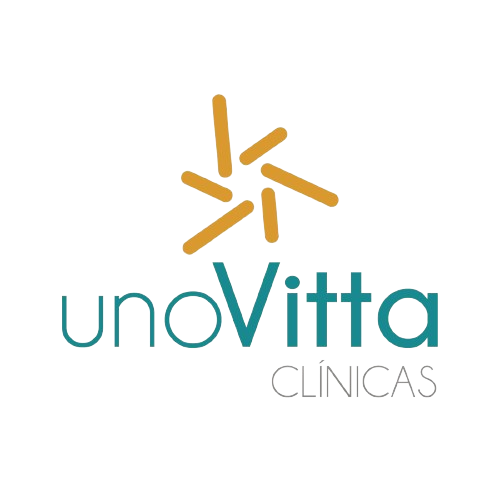
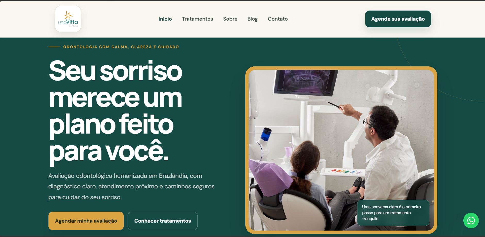

# UnoVitta Clínicas

<p align="center">
  
</p>

<p align="center">
  <strong>Odontologia com calma, clareza e cuidado.</strong><br />
  Website institucional da UnoVitta Clínicas · Brazlândia, Brasília, DF
</p>

<p align="center">
  <a href="https://www.unovitta.com.br" target="_blank" rel="noopener noreferrer">
    
  </a>
</p>

<p align="center">
  <a href="#visão-geral">Visão Geral</a> ·
  <a href="#link-de-acesso">Link de Acesso</a> ·
  <a href="#funcionalidades">Funcionalidades</a> ·
  <a href="#tecnologias">Tecnologias</a> ·
  <a href="#desenvolvimento-local">Desenvolvimento</a>
</p>

---

## Print da página inicial

<p align="center">
  
</p>

---

## 🩺 Visão Geral

Este repositório contém o código-fonte do website institucional da **UnoVitta Clínicas**, clínica odontológica localizada em Brazlândia, Brasília/DF. 

A aplicação apresenta a filosofia da clínica, os tratamentos oferecidos, conteúdos educativos de prevenção e saúde bucal, além de atalhos e canais diretos para agendamento de consultas via WhatsApp.

A interface utiliza uma identidade visual acolhedora e editorial — combinando tons de verde-floresta, marfim, verde-sálvia e âmbar — projetada para transmitir confiança clínica, excelente legibilidade e chamadas de ação (CTAs) objetivas.

---

## 🔗 Link de Acesso

O site está publicado e disponível para navegação em:

👉 **[https://www.unovitta.com.br](https://www.unovitta.com.br)**

---

## 🦷 Tratamentos & Especialidades

- **Implantes Dentários:** Reabilitação oral com técnicas seguras e planejamento guiado.
- **Alinhadores Transparentes:** Ortodontia moderna, discreta e confortável.
- **Odontologia Estética & Lentes:** Facetas, lentes de contato dental e harmonização do sorriso.
- **Clareamento Dental:** Procedimentos de clareamento a laser e caseiro supervisionado.
- **Clínica Geral & Prevenção:** Limpeza, restaurações, tratamento de canal e manutenção preventiva.

---

## ✨ Funcionalidades

- **Página Inicial Editorial:** Apresentação humanizada, diferenciais do atendimento, etapas de diagnóstico, depoimentos e localização.
- **Páginas Estratégicas por Tratamento:** Páginas individuais com conteúdos focados em conversão, FAQ específica e SEO dinâmico.
- **Blog Educativo:** Artigos informativos focados em saúde bucal, cuidados e prevenção.
- **Canais Diretos de Contato:** Formulário responsivo, botão flutuante animado do WhatsApp, e-mail e ligação direta.
- **Design Responsivo & Acessibilidade:** Experiência fluida em mobile, tablet e desktop, com HTML semântico e navegação via teclado.
- **SEO & Dados Estruturados:** Metatags completas, Open Graph, Twitter Cards, Schema.org (`LocalBusiness`, `FAQPage`, `MedicalWebPage`, `BlogPosting`), sitemap.xml e robots.txt.
- **Conversão de WhatsApp:** Os links de contato usam a conversão direta do Google Ads (`AW-962820594`), centralizada em `src/utils/analytics.ts`. O compartilhamento de artigos pelo WhatsApp não é contado como lead. Cliques em telefone continuam registrados separadamente como evento `phone_click`.

---

## 🛠️ Tecnologias Utilizadas

| Tecnologia | Função |
| --- | --- |
| **React 19** | Componentização modular da interface |
| **TypeScript 5** | Tipagem estática e segurança na compilação |
| **Vite** | Servidor de desenvolvimento rápido e bundler otimizado |
| **React Router DOM 7** | Gerenciamento de rotas e navegação SPA |
| **Styled Components** | Estilização escopada com tokens de design |
| **React Icons** | Biblioteca de ícones vetoriais |
| **Schema.org / JSON-LD** | Marcação de dados estruturados para SEO |

---

## 🎨 Identidade Visual (Tokens)

| Token | Cor | Aplicação |
| --- | --- | --- |
| `--color-primary` | `#164B45` | Hero, cabeçalho, botões e elementos institucionais |
| `--color-primary-dark` | `#103A35` | Rodapé e seções de maior destaque |
| `--color-secondary` | `#D9A441` | Destaques em âmbar, botões de ação e divisores |
| `--color-accent` | `#8DAF9F` | Acentos sutis e fundos suaves em verde-sálvia |
| `--color-gray-100` | `#FAF7F1` | Fundo principal marfim institucional |
| `--color-dark` | `#1A302D` | Tipografia de alto contraste para leitura |

---

## 📁 Estrutura do Projeto

```text
unovitta-v2/
├── src/
│   ├── App.tsx                        # Rotas e layout global
│   ├── components/
│   │   ├── SEO/                       # Gerenciamento de Metatags e JSON-LD
│   │   ├── layout/
│   │   │   ├── Header/                # Navegação superior e CTA principal
│   │   │   └── Footer/                # Rodapé institucional e contatos
│   │   ├── sections/                  # Seções reutilizáveis da Home
│   │   ├── ui/                        # Componentes genéricos da interface
│   │   └── WhatsAppButton/            # Botão flutuante do WhatsApp
│   ├── pages/
│   │   ├── Home/                      # Página inicial
│   │   ├── Treatment/                 # Template dinâmico de tratamento por slug
│   │   ├── Services/                  # Índice de serviços
│   │   ├── About/                     # Sobre a clínica e equipe
│   │   ├── Blog/                      # Lista de artigos
│   │   ├── BlogPost/                  # Leitura de artigo individual
│   │   └── Contact/                   # Formulário e informações
│   ├── styles/
│   │   └── GlobalStyles.ts            # Tokens de cor, tipografia e reset
│   └── utils/
│       ├── analytics.ts               # Eventos de conversão
│       └── whatsapp.ts                # Formatador de mensagens e links
├── scripts/
│   └── prerender.mjs                  # Pré-renderização das rotas do sitemap
├── public/
│   ├── images/                        # Ativos visuais e fotos
│   ├── _redirects                     # Fallback de rotas na hospedagem
│   ├── iconyellow.png
│   ├── logo.png
│   ├── print.png                       # Captura da página inicial
│   ├── robots.txt
│   └── sitemap.xml
├── index.html
├── package.json
└── README.md
```

---

## 💻 Desenvolvimento Local

### Pré-requisitos

- Node.js 20 ou superior
- npm 10 ou superior

### Passo a passo

```bash
# 1. Clonar o repositório
git clone https://github.com/Salasfernando/unovitta.git
cd unovitta

# 2. Instalar dependências
npm install

# 3. Iniciar o servidor local
npm run dev
```

A aplicação ficará disponível em `http://localhost:5173`.

### Scripts de Qualidade e Build

```bash
# Executar validação do ESLint
npm run lint

# Gerar compilação otimizada para produção
npm run build

# Testar o build localmente
npm run preview
```

---

## 🗺️ Rotas Principais

| Rota | Conteúdo |
| --- | --- |
| `/` | Página Inicial |
| `/servicos` | Visão geral dos tratamentos |
| `/servicos/implantes` | Página de Implantes Dentários |
| `/servicos/alinhadores` | Página de Alinhadores Transparentes |
| `/servicos/estetica` | Página de Odontologia Estética & Lentes |
| `/servicos/clareamento` | Página de Clareamento Dental |
| `/sobre` | Sobre a UnoVitta e Filosofia |
| `/blog` | Índice de conteúdos e artigos |
| `/blog/:slug` | Artigo do Blog |
| `/contato` | Canais de atendimento e formulário |

---

## 📞 Contato

**UnoVitta Clínicas**  
📍 Brazlândia · Brasília, DF  
📞 Telefone/WhatsApp: [(61) 3479-4514](tel:+556134794514)
🌐 Site: [https://www.unovitta.com.br](https://www.unovitta.com.br)  

[Conversar pelo WhatsApp](https://wa.me/556134794514)

---

## 📜 Licença e Direitos

© 2026 UnoVitta Clínicas. Todos os direitos reservados.

Desenvolvido por **Salas Tech**.
